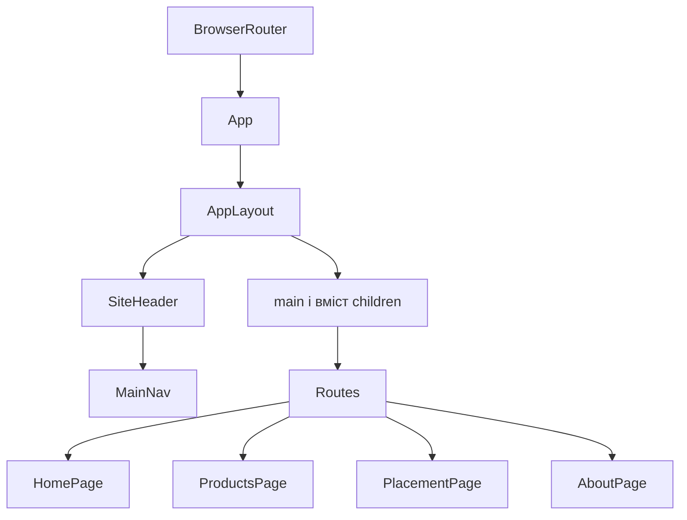
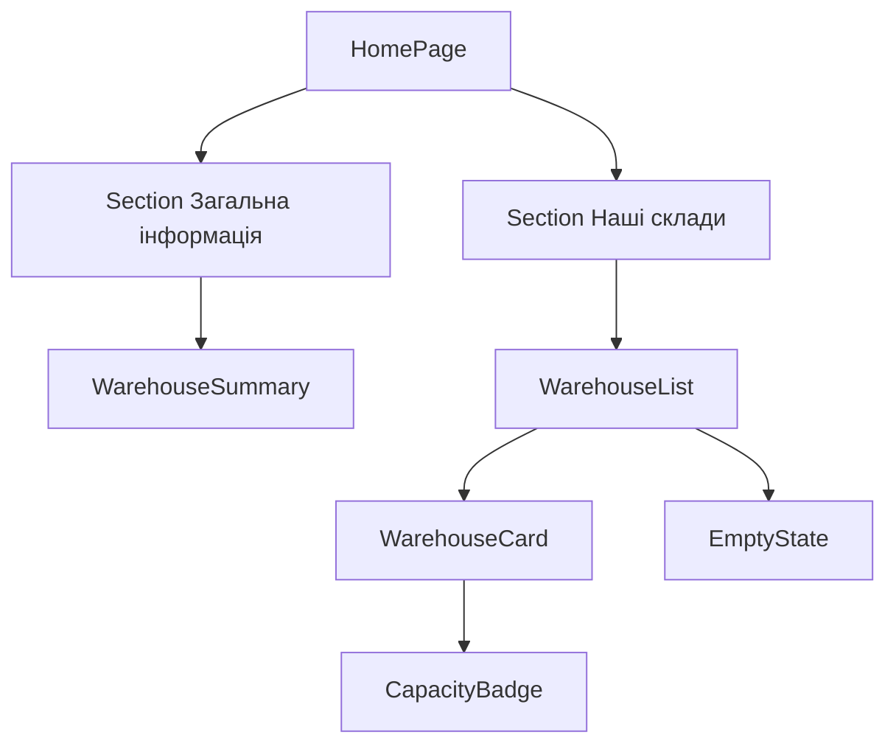
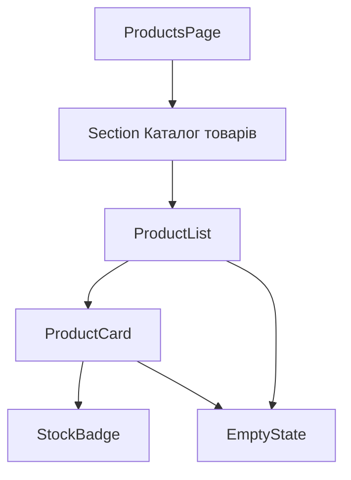
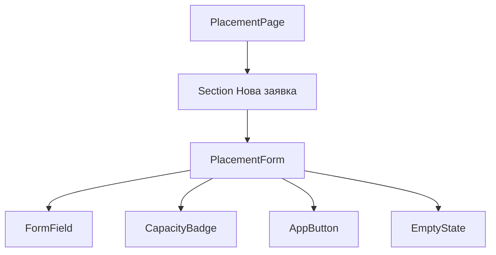

# Архітектура веб-сайту розміщення товарів по складах

## Призначення проєкту

Навчальний застосунок показує склади, їх заповненість і товари. Сторінка розміщення реалізує сценарій: користувач вибирає товар, склад, кількість та потрібні місця зберігання й формує локальну заявку. Залишки товарів не змінюються. Дані задані масивами в `src/data/inventory.js`.

Застосунок поділено на сторінки огляду складів, каталогу товарів, розміщення та опису системи. Спільний каркас, навігація, секції й поля форми винесені в окремі компоненти. Для оформлення використано styled-components.

## Сторінки і сценарії

| Сторінка | Маршрут | Дії користувача |
|---|---|---|
| HomePage | / | Перегляд складів, місткості, зайнятих і вільних місць |
| ProductsPage | /products | Перегляд товарів, залишків і їх розміщення на різних складах |
| PlacementPage | /placement | Вибір товару та складу, введення кількості й місць, формування навчальної заявки |
| AboutPage | /about | Перегляд опису призначення системи |

## Спільна ієрархія



У Routes одночасно відображається сторінка поточного маршруту. Каркас AppLayout не створює другого main або другого BrowserRouter.

## Головна сторінка



HomePage поєднує компоненти загальної інформації та списку складів. WarehouseList відповідає за перебір масиву, WarehouseCard відображає один склад, CapacityBadge визначає напис і колір індикатора заповненості.

## Товари та форма





FormField повторюється для двох select і двох input. Окремі ProductSelect і WarehouseSelect не потрібні в цій реалізації: список option формує PlacementForm, а спільні підпис і підказку надає FormField.

## Контракти props

| Компонент | Props | Домовленості |
|---|---|---|
| AppLayout | title: string; links: array; children: ReactNode | Створює заголовок, навігацію та єдиний main; вміст приходить через children |
| SiteHeader | title: string; links: array | Виводить назву й передає links до MainNav |
| MainNav | links: array of {to, label} | Кожний to унікальний; активний маршрут виділяється NavLink |
| Section | id: string; title: string; children: ReactNode | id має бути унікальним на сторінці; заголовок пов'язаний із секцією через aria-labelledby |
| WarehouseSummary | items: Warehouse[] | Обчислює загальну кількість складів, зайнятих і вільних місць |
| WarehouseList | items: Warehouse[] = [] | Для порожнього масиву виводить EmptyState; кожний id унікальний |
| WarehouseCard | warehouse: Warehouse | Warehouse має id, name, address, capacity, occupied |
| CapacityBadge | occupied: number; capacity: number | Для даних складу 0 ≤ occupied ≤ capacity; місткість вимірюється в місцях; capacity ≤ 0 обробляється окремо |
| ProductList | items: Product[] = [] | Для порожнього масиву виводить EmptyState |
| ProductCard | product: Product | Product має id, name, sku, unit, placements; кожне розміщення має warehouseId, warehouseName, quantity |
| StockBadge | quantity: number; unit: string | Показує сумарну кількість або відсутність товару |
| PlacementForm | products: Product[]; warehouses: Warehouse[]; onSubmit: function | Викликає onSubmit({productId, warehouseId, quantity, positions}) лише після перевірки; обидві числові величини додатні цілі |
| FormField | id: string; label: string; hint?: string; children: ReactNode | Дочірній input/select має такий самий id; для hint поле задає aria-describedby як id-hint |
| AppButton | type = button; onClick?: function; disabled = false; children: ReactNode | Для форми задається type=submit; кнопка показує children |
| EmptyState | message: string = Дані відсутні | Універсальне повідомлення для відсутніх даних |
| HomePage | warehouses: Warehouse[] | Створює композицію головної сторінки із загальною інформацією та списком складів |
| ProductsPage | products: Product[] | Компонент сторінки передає дані списку |
| PlacementPage | products: Product[]; warehouses: Warehouse[] | Зберігає останню сформовану заявку в локальному стані |
| AboutPage | Власні вхідні props не використовуються | Відображає опис призначення системи |

## Композиція через children

```jsx
<Section id="warehouses" title="Наші склади">
  <WarehouseList items={warehouses} />
</Section>
```

Section відповідає за семантичну секцію і заголовок, а WarehouseList надходить через children. Той самий Section використовується для каталогу товарів і форми.

```jsx
<FormField id="warehouse" label="Склад">
  <select id="warehouse">...</select>
</FormField>
```

FormField надає підпис і структуру поля. Конкретний select або input надходить через children. AppLayout також отримує сторінки як children.

## Повторне використання у змістовних місцях

| Компонент | Перше місце | Друге місце |
|---|---|---|
| Section | Список складів на HomePage | Каталог на ProductsPage та форма на PlacementPage |
| CapacityBadge | WarehouseCard під час перегляду складів | PlacementForm після вибору складу |
| EmptyState | WarehouseList, якщо складів немає | ProductList, ProductCard і PlacementForm для відсутніх даних |
| FormField | Вибір товару і складу | Введення кількості товару і потрібних місць |

Компоненти не змінюють вхідні props. Взаємодія відбувається через локальний стан, callbacks від батьківських компонентів і контекст вибраного товару.

## Відповідність завданням

| Завдання ЛР 1.2 | Реалізація |
|---|---|
| 1 Аналіз та ієрархія | Сценарії, таблиця сторінок і схеми в цьому файлі |
| 2 Спільне компонування | AppLayout, SiteHeader, MainNav; спільний каркас і працездатна навігація між сторінками |
| 3 Сторінка список картка | HomePage → WarehouseList → WarehouseCard; ProductsPage → ProductList → ProductCard |
| 4 Props і children | Контракти props; AppLayout, Section, FormField, AppButton |
| 5 Повторне використання й наступна сторінка | Section, CapacityBadge, FormField, EmptyState; PlacementPage із макетом форми |
| 6 React Bootstrap | Ознайомлення з документацією і прикладом Button; вибрано наявний styled-components |
| 7 Перевірка і Git | Сценарії в README; цей файл оновлює архітектурні матеріали; зміни збережено в GitHub |

## ЛР 2.1: керування станом та подіями

Застосунок використовує стан React для пошуку, вибору товару, роботи форми та повідомлення про сформовану заявку. Початкові дані товарів і складів залишаються в `src/data/inventory.js`; заявка створюється локально й не змінює залишки.

### Карта стану

| Стан | Власник | Хто використовує | Чому тут |
|---|---|---|---|
| `detailsOpen` | `ProductCard` | Та сама картка | Показ і приховування деталей стосується лише одного товару |
| `query`, `inStockOnly` | `useProductFilters`, викликаний у `ProductsPage` | Пошук, перемикач і список | Фільтрація потрібна тільки каталогу; `visibleProducts` обчислюється з вхідного масиву |
| `selectedProductId` | `ProductSelectionProvider` | `ProductsPage`, `PlacementPage`, картки й форма через props | Вибір зберігається під час переходу між сторінками |
| `draft` (`warehouseId`, `quantity`, `positions`) | `PlacementPage` | `PlacementForm` і підсумок чернетки | Форма та підсумок мають бачити однакові значення |
| `request` | `PlacementPage` | Повідомлення після надсилання | Остання заявка показується на сторінці; це локальний результат |
| `error` | `PlacementForm` | Валідація і повідомлення в цій формі | Помилка потрібна тільки формі |

### Передавання подій і підняття стану

`ProductCard` викликає `onSelect(product.id)`; `ProductList` передає callback зі сторінки каталогу. `ProductsPage` використовує `setSelectedProductId` із контексту. Той самий `selectedProductId` доступний `PlacementPage`, тому вибраний товар з’являється у формі після навігації.

`PlacementForm` є керованою формою: кожен `value` бере значення з `draft`, а `onChange` викликає `onDraftChange(field, value)` у `PlacementPage`. Оновлення одного поля зберігає інші:

```jsx
setDraft((previous) => ({
  ...previous,
  [field]: value,
}));
```

`onSubmit` передає перевірені значення до `PlacementPage`, який зберігає `request` і показує повідомлення. Зміна товару очищає чернетку та заявку; кнопка «Очистити поля» очищає їх без скасування вибору товару. Місткість складу перевіряється перед формуванням заявки.

### Хук, контекст і ефект

`useProductFilters(products)` зберігає текст пошуку й перемикач «Лише товари в наявності» та повертає `visibleProducts`. Цей список обчислюється з `products`, `query` і `inStockOnly`, окремо в стані не зберігається.

`ProductSelectionContext` містить `selectedProductId` і `setSelectedProductId`. `ProductSelectionProvider` охоплює маршрути застосунку, а `useProductSelection()` використовується на обох сторінках.

На `PlacementPage` ефект змінює `document.title` відповідно до вибраного товару. Його залежність — `[pageTitle]`: при зміні назви ефект виконується знову, а функція очищення відновлює попередній заголовок після виходу зі сторінки.

### Перевірений сценарій

У каталозі пошукати товар, вибрати його, перейти на сторінку розміщення, вибрати склад, указати кількість і місця, перевірити підсумок та сформувати заявку. Окремо перевірити скасування вибору, очищення полів, помилки порожніх або некоректних значень і зміну назви вкладки. Проєкт успішно збирається командою `npm.cmd run build`.

## Джерела для пояснень

- React props і children: https://react.dev/learn/passing-props-to-a-component
- React Router: https://reactrouter.com/start/declarative/routing
- styled-components: https://styled-components.com/docs/basics
- React Bootstrap: https://react-bootstrap.github.io/docs/getting-started/introduction/
