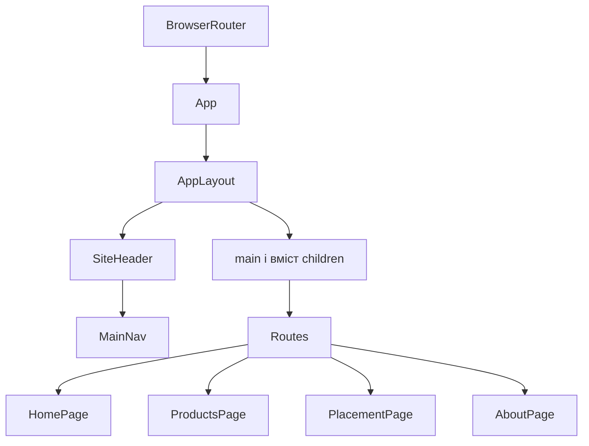
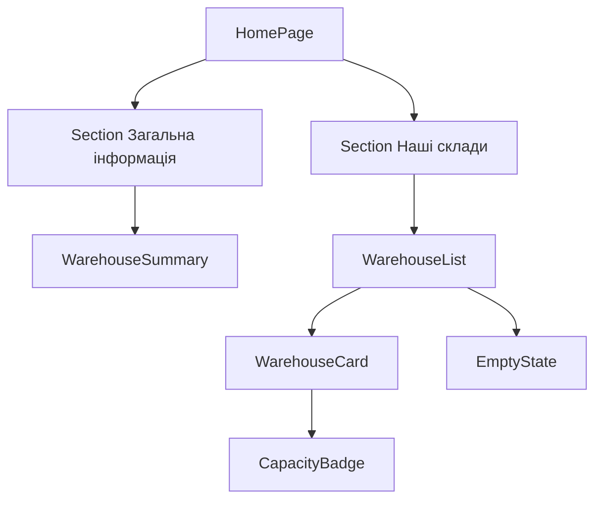
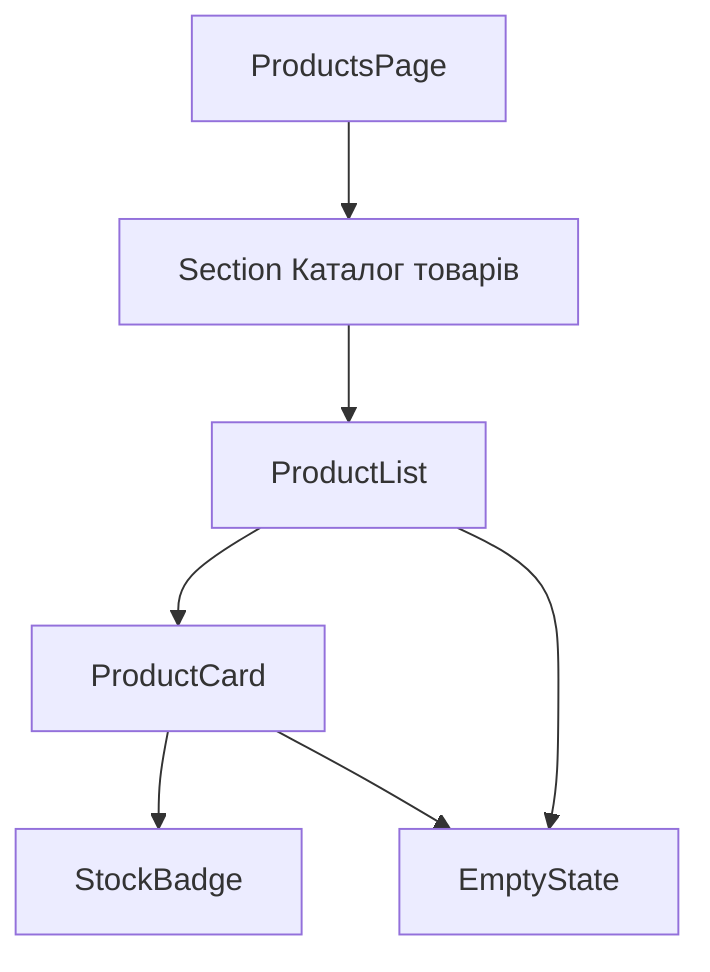
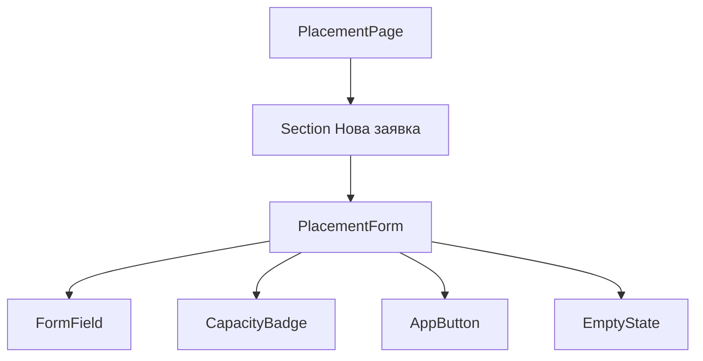

# Архітектура веб-сайту розміщення товарів по складах

## Призначення і межі ЛР 1.2

Навчальний застосунок показує склади, їх заповненість і товари. Сторінка розміщення є основою наступного сценарію: користувач вибирає товар, склад, кількість та потрібні місця зберігання й формує локальну заявку. Залишки товарів не змінюються. Дані задані масивами в `src/data/inventory.js`.

З ЛР 1.1 збережені переходи «Головна» — «Про нас», компоненти Hello та Goodbye, кнопка зміни стану й styled-components. Складська тематика додана як розвиток початкового навчального застосунку.

## Сторінки і сценарії

| Сторінка | Маршрут | Дії користувача |
|---|---|---|
| HomePage | / | Перегляд складів, місткості, зайнятих і вільних місць; перевірка початкової кнопки зміни тексту |
| ProductsPage | /products | Перегляд товарів, залишків і їх розміщення на різних складах |
| PlacementPage | /placement | Вибір товару та складу, введення кількості й місць, формування навчальної заявки |
| AboutPage | /about | Перегляд опису призначення системи |

## Спільна ієрархія



У Routes одночасно відображається сторінка поточного маршруту. Каркас AppLayout не створює другого main або другого BrowserRouter.

## Головна сторінка



HomePage поєднує компоненти, WarehouseList відповідає за перебір масиву, WarehouseCard відображає один склад, CapacityBadge визначає напис і колір заповненості. Окрема Section «Демонстрація стану» містить Hello, Goodbye, StateMessage і AppButton. Стан кнопки зберігає HomePage; StateMessage отримує тільки changed.

## Товари та форма





FormField повторюється для двох select і двох input. Окремі ProductSelect і WarehouseSelect не потрібні в цій реалізації: список option формує PlacementForm, а спільні підпис і підказку надає FormField.

## Контракти props

| Компонент | Props | Домовленості |
|---|---|---|
| AppLayout | title: string; links: array; children: ReactNode | Створює заголовок, навігацію та єдиний main; вміст приходить через children |
| SiteHeader | title: string; links: array | Виводить назву й передає links до MainNav |
| MainNav | links: array of {to, label} | Кожний to унікальний; активний маршрут виділяється NavLink |
| Section | id: string; title: string; children: ReactNode | id має бути унікальним на сторінці; заголовок пов'язаний із секцією через aria-labelledby |
| WarehouseSummary | items: Warehouse[] | Обчислює загальну кількість складів, зайнятих і вільних місць |
| WarehouseList | items: Warehouse[] = [] | Для порожнього масиву виводить EmptyState; кожний id унікальний |
| WarehouseCard | warehouse: Warehouse | Warehouse має id, name, address, capacity, occupied |
| CapacityBadge | occupied: number; capacity: number | Для даних складу 0 ≤ occupied ≤ capacity; місткість вимірюється в місцях; capacity ≤ 0 обробляється окремо |
| ProductList | items: Product[] = [] | Для порожнього масиву виводить EmptyState |
| ProductCard | product: Product | Product має id, name, sku, unit, placements; кожне розміщення має warehouseId, warehouseName, quantity |
| StockBadge | quantity: number; unit: string | Показує сумарну кількість або відсутність товару |
| PlacementForm | products: Product[]; warehouses: Warehouse[]; onSubmit: function | Викликає onSubmit({productId, warehouseId, quantity, positions}) лише після перевірки; обидві числові величини додатні цілі |
| FormField | id: string; label: string; hint?: string; children: ReactNode | Дочірній input/select має такий самий id; для hint поле задає aria-describedby як id-hint |
| AppButton | type = button; onClick?: function; disabled = false; children: ReactNode | Для форми задається type=submit; кнопка показує children |
| EmptyState | message: string = Дані відсутні | Універсальне повідомлення для відсутніх даних |
| StateMessage | changed: boolean | Виводить початковий або змінений текст; стан не змінює |
| HomePage | warehouses: Warehouse[] | Створює композицію головної сторінки і містить стан початкової кнопки |
| ProductsPage | products: Product[] | Компонент сторінки передає дані списку |
| PlacementPage | products: Product[]; warehouses: Warehouse[] | Зберігає останню сформовану заявку в локальному стані |

## Композиція через children

```jsx
<Section id="warehouses" title="Наші склади">
  <WarehouseList items={warehouses} />
</Section>
```

Section відповідає за семантичну секцію і заголовок, а WarehouseList надходить через children. Той самий Section використовується для каталогу товарів і форми.

```jsx
<FormField id="warehouse" label="Склад">
  <select id="warehouse">...</select>
</FormField>
```

FormField надає підпис і структуру поля. Конкретний select або input надходить через children. AppLayout також отримує сторінки як children.

## Повторне використання у змістовних місцях

| Компонент | Перше місце | Друге місце |
|---|---|---|
| Section | Список складів на HomePage | Каталог на ProductsPage та форма на PlacementPage |
| CapacityBadge | WarehouseCard під час перегляду складів | PlacementForm після вибору складу |
| AppButton | HomePage для зміни тексту | PlacementForm для формування заявки |
| EmptyState | WarehouseList, якщо складів немає | ProductList, ProductCard і PlacementForm для відсутніх даних |
| FormField | Вибір товару і складу | Введення кількості товару і потрібних місць |

Компоненти не змінюють вхідні props. Взаємодія відбувається через локальний стан і функцію onSubmit, яку передає батьківський компонент.

## Відповідність завданням

| Завдання ЛР 1.2 | Реалізація |
|---|---|
| 1 Аналіз та ієрархія | Сценарії, таблиця сторінок і схеми в цьому файлі |
| 2 Спільне компонування | AppLayout, SiteHeader, MainNav; збережені початкові маршрути й кнопка |
| 3 Сторінка список картка | HomePage → WarehouseList → WarehouseCard; ProductsPage → ProductList → ProductCard |
| 4 Props і children | Контракти props; AppLayout, Section, FormField, AppButton |
| 5 Повторне використання й наступна сторінка | Section, CapacityBadge, AppButton; PlacementPage із макетом форми |
| 6 React Bootstrap | Ознайомлення з документацією і прикладом Button; вибрано наявний styled-components |
| 7 Перевірка і Git | Сценарії в README; цей файл оновлює архітектурні матеріали; commit і push виконує власник репозиторію після інтеграції |

## Джерела для пояснень

- React props і children: https://react.dev/learn/passing-props-to-a-component
- React Router: https://reactrouter.com/start/declarative/routing
- styled-components: https://styled-components.com/docs/basics
- React Bootstrap: https://react-bootstrap.github.io/docs/getting-started/introduction/
